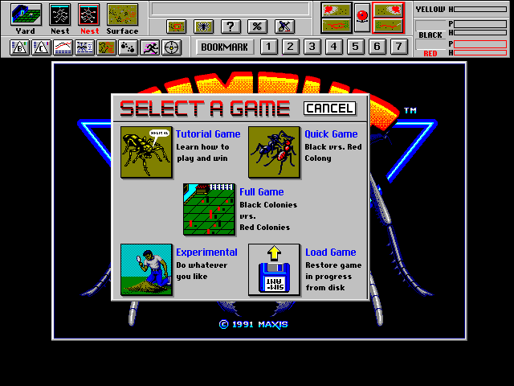

# SimAnt — Static Recompilation

Static recompilation of **SimAnt: The Electronic Ant Colony** for Windows
(Maxis, 1991) from its shipping Win16 binary, `SIMANTW.EXE`, to native C.

Built on [pcrecomp](https://github.com/sp00nznet/pcrecomp)'s Win16 NE toolchain
and host runtime, the same code that runs [Catz](https://github.com/sp00nznet/catz-recomp),
Dogz and Oddballz. This repository holds only what is SimAnt's own: how to
lift it, the few facts about the game the runtime needs, and the notes.



## Status

**Pre-alpha: it boots to its game-select screen.**

Every function lifts and links (12,612 lifted blocks, 0 unresolved calls).
The game runs its C startup and WinMain, registers its window classes, reads
`SIMANT.CFG`, opens its `SHARED`, `WINGANT` and `SOUND` databases, and draws
its ribbon bar, title screen and **Select a Game** dialog, all from the game's
own code. It has not been played past that screen. See [ROADMAP.md](ROADMAP.md).

| | |
|---|---|
| Binary | `SIMANTW.EXE`, 516,096 bytes, NE, MS C, linker 5.30 |
| Code | 7 segments, 334,099 bytes |
| Data | 3 segments; DGROUP is seg 10 |
| Imports | KERNEL, USER, GDI, SOUND, KEYBOARD, WIN87EM (195 functions) |
| Symbols | **`SIMANTW.SYM` ships with the game**: 2,191 names, every function |

### The symbol file

Maxis shipped `SIMANTW.SYM` beside the EXE. It's MAPSYM's condensed linker
map, which was there for the debugger. It names every function in the game:
`_AddSomeAnts`, `_QueenMoveB`, `_PickupMyFood`, `_db_SetDataBase`, `WINMAIN`.
`tools/relift.py` reads it with pcrecomp's `tools/ne/mapsym.py` and passes
every entry to the lifter as a seed. Function boundaries therefore come from
Maxis's linker rather than from IDA's guesses. That mattered twice on the way
to the first screen: IDA desynced over `__cinit` and made `pop di; leave` into
data. The names also go to `work/names.txt`, which turns a `seg007_81AC` in a
trace back into `_db_SetDataBase`.

## What it took

SimAnt is the first program built with **Microsoft C** to run on the Win16
path. Catz, Dogz and Oddballz are Borland. These fixes landed in pcrecomp
([#114](https://github.com/sp00nznet/pcrecomp/pull/114)), where every Win16
title gets them:

- **`InitTask` returned CX=0xFFFE.** Windows returns the stack size there. MS C's
  crt0 adds 256 bytes and exits on the carry, so the game quit with code 255
  before running a line of its own code.
- **Far calls through a SELECTOR fixup** took their offset from the fixup
  record (0) rather than the instruction, so the startup called `seg1:0000`
  instead of `WINMAIN` at `seg1:3FDA`.
- **SYM seeds beat IDA**: an entry that lands inside an IDA instruction evicts
  that instruction.
- **Fall-through gaps**: when IDA calls bytes data straight after an
  instruction that falls through, they are decoded as code, provided they
  resync exactly onto the next instruction.
- **36 missing purges** and nine shims (`GetFreeSpace`, `GlobalCompact`,
  `TextOut`, `SetProp`, `wvsprintf`, …).

## Building

You need your own copy of SimAnt for Windows. Nothing from the game is in this
repository, and nothing ever will be.

1. Install [MSYS2](https://www.msys2.org/) with `mingw-w64-x86_64-gcc`,
   `mingw-w64-x86_64-cmake` and `ninja`, and put `C:\msys64\mingw64\bin` on `PATH`.
2. Install Python 3.11+, and IDA Pro 9 with idalib for the code map.
3. Check out [pcrecomp](https://github.com/sp00nznet/pcrecomp) next to this
   repository as `tools/` (or set `PCRECOMP_DIR`).
4. Copy your installed game into `game/`: `SIMANTW.EXE`, `SIMANTW.SYM`, the
   `.DAT`/`.NDX` files, `SIMANT.CFG`, the fonts and `SOUND/`.
5. Lift, configure and build:

```bash
python tools/relift.py --ida        # once; later relifts can drop --ida
cmake -S . -B build -G Ninja
ninja -C build
build/simant.exe
```

`scripts/grab.ps1` runs the game and saves its window to `work/grab.png`.

The lifted C is written to `work/`, which is gitignored. It is a derivative of
your copy of the game and is never committed. See [LICENSE](LICENSE).

## License

MIT for what this repository holds. The game, its symbol file and everything
lifted from it are not covered. See [LICENSE](LICENSE).
